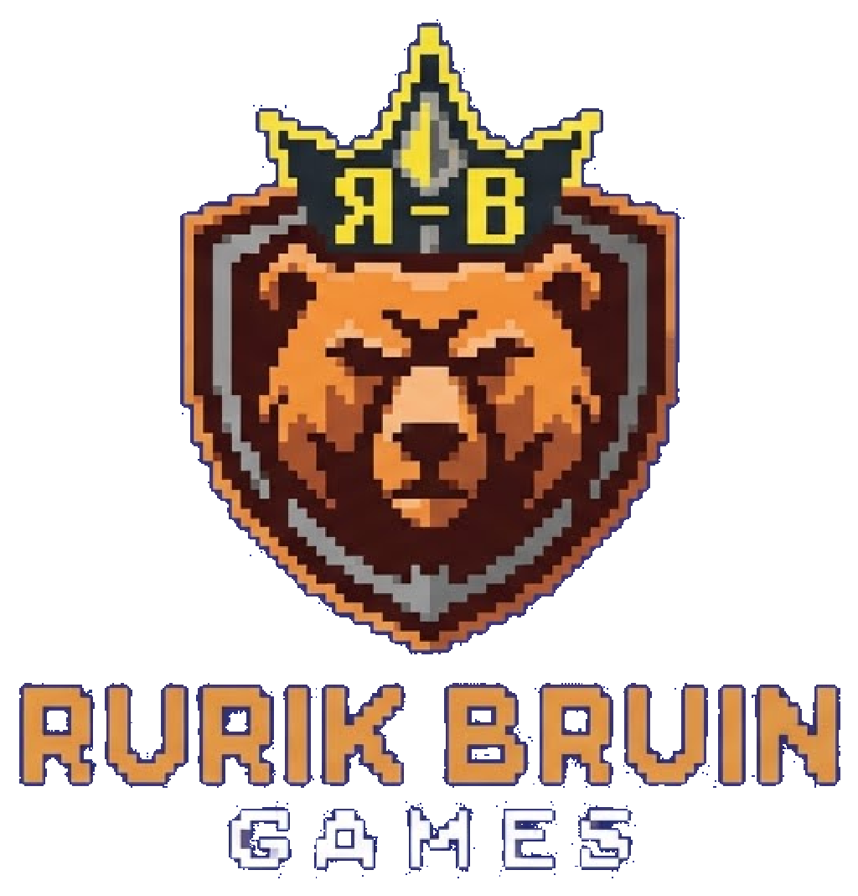

When designing the visual identity for **Rurik Bruin Games**, we wanted every pixel on `rurikbruin.com`—from our bear emblem to our site background and text highlights—to obey the same hardware constraints as our games.

That meant building our entire brand kit strictly out of the **16-color Commodore 64 VIC-II palette**.

---

### 🎨 The 16-Color VIC-II Palette

Our site styling, logos, and banners are built around the classic **16-color Commodore 64 VIC-II palette** (using **Pepto** values for our site CSS):

| Index | C64 Color Name | Hex Code | Studio / Site Role |
| :---: | :--- | :---: | :--- |
| **0** | Black | `#000000` | Deep shadows, outlines & contrast framing |
| **1** | White | `#FFFFFF` | Primary highlights & crisp text accents |
| **2** | Red | `#813338` | **R** in **R.B.G.** emblem & danger/alert accents |
| **3** | Cyan | `#75CEC8` | Retro screen highlights & link hover states |
| **4** | Purple | `#8E3C97` | Secondary retro accents |
| **5** | Green | `#56AC4D` | **G** in **R.B.G.** emblem & status indicators |
| **6** | Blue | `#2E2C9B` | Classic C64 screen background & **B** in **R.B.G.** |
| **7** | Yellow | `#EDF171` | Gold trim, headings & active highlights |
| **8** | Orange | `#8E5029` | Warm wood/fur midtones |
| **9** | Brown | `#553800` | Bruin bear emblem primary fur & dark earth tones |
| **10** | Light Red | `#C46C71` | Warm highlight shading |
| **11** | Dark Grey | `#4A4A4A` | Panel borders & subtle dividers |
| **12** | Medium Grey | `#7B7B7B` | Secondary body text & muted UI elements |
| **13** | Light Green | `#A9FF9F` | Terminal text & bright sprite accents |
| **14** | Light Blue | `#706DEB` | Classic C64 border & primary readable body text |
| **15** | Light Grey | `#B2B2B2` | Standard light UI text & metallic shading |

---

### 🛡️ Logos, Icons & Banners

Need official **Rurik Bruin Games** artwork for press coverage, YouTube thumbnails, or itch.io features? Feel free to use the assets below—just keep the proportions intact and avoid recoloring outside the 16-color VIC-II palette.

#### Primary Studio Logo

* **Transparent PNG:** [Download `logo-transparent.png`](/assets/images/logo-transparent.png)

#### Icons & Favicons
* **Studio Icon / Avatar:** [Download `avatar.png`](/assets/images/avatar.png)
* **Favicon:** [Download `favicon.png`](/assets/images/favicon.png)

#### Banners (itch.io, GitHub & Social)
* **Wide Studio Banner:** [Download `banner.png`](/assets/images/banner.png)

---

### 📐 Design & Usage Notes

* **Pixel-Crisp Scaling:** All logos and icons are pixel-art native. When scaling up for video or print, always use **Nearest-Neighbor** interpolation so edges stay razor-sharp without blurring.
* **The R.B.G. Motif:** Our emblem pairs **R**ed (`#813338`), **B**lue (`#2E2C9B`), and **G**reen (`#56AC4D`)—honoring founder **R**oderick **B**ernard **G**reening alongside the primary RGB pixels of classic display hardware.

Have questions about our assets or need a custom resolution for a feature? Reach out anytime at [contact@rurikbruin.com](mailto:contact@rurikbruin.com).

