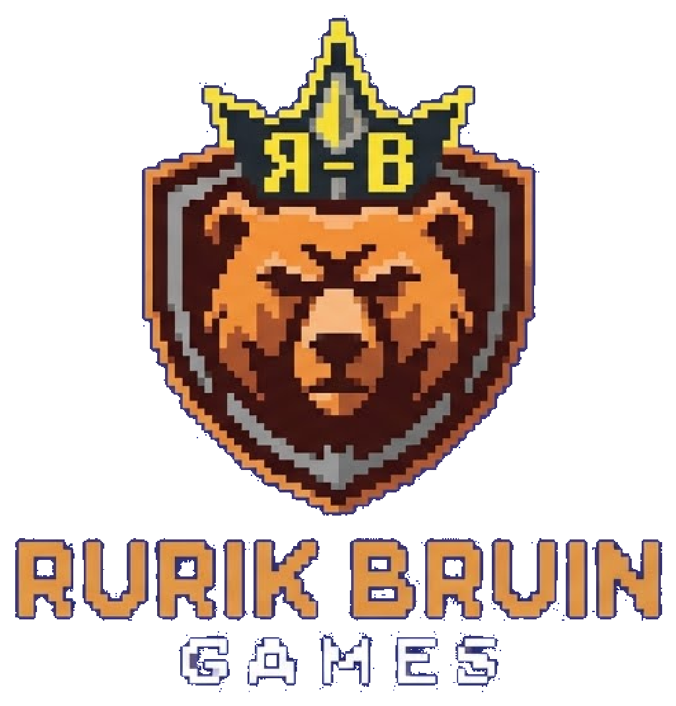

Crafting retro-inspired games, documenting the journey, and sharing what I learn along the way.

<nav class="studio-nav">
  <a href="#games">Games</a> • 
  <a href="#devlogs">Devlogs & Articles</a> • 
  <a href="#about">About</a> • 
  <a href="#connect">Connect</a>
</nav>

---

## 🎮 Games & Projects {#games}

* **Project Bear (Working Title)** — *In Active Development.* My debut solo indie title built from scratch, blending classic 8-bit sensibility with modern game design.
* **Prototypes & Game Jams** — Early playable builds and mechanics experiments published over on [rurikbruin.itch.io](https://itch.io).

---

## 📝 Latest Devlogs & Articles {#devlogs}


  
* **[{{ post.title }}]({{ post.url }})** — *{{ post.date | date: "%B %-d, %Y" }}*  
  {{ post.excerpt | strip_html | truncatewords: 25 }}
  

* **First Devlog Coming Soon** — Follow along for behind-the-scenes breakdowns on pixel art, game mechanics, code snippets, and solo dev lessons from the trenches.


---

## 🛡️ Behind the Studio {#about}

Based in Canada, this independent workshop is run by solo developer **Roderick Bernard Greening**. Every part of the studio's identity ties back to personal heritage and the craft of game making:

* **Rurik (*Roderick*):** Drawn from the Old Norse *Hrœrekr* and East Slavic *Rurik*—the historical roots of *Roderick*, meaning *"famous ruler."*
* **Bruin (*Bernard*):** Inspired by the Old Germanic *Berinhard* ("brave as a bear") and the classic folkloric name for a brown bear—representing steady endurance and craftsmanship.
* **The R.B.G. & C64 Connection:** The initials **R.B.G.** bridge **R**oderick **B**ernard **G**reening with the **R**ed, **B**lue, and **G**reen pixels of classic computing—framed in an authentic 16-color Commodore 64 VIC-II palette honoring the 8-bit roots that inspired the studio.

---

## 🕹️ Connect & Follow {#connect}

Want to playtest early builds, watch devlog clips, or swap notes?

* **Playable Builds:** [itch.io](https://itch.io)
* **Devlog Videos:** [YouTube](https://youtube.com)
* **Updates:** [Bluesky](https://bsky.app) | [X](https://x.com)
* **Code & Tools:** [GitHub](https://github.com)
* **Direct Email:** [contact@rurikbruin.com](mailto:contact@rurikbruin.com)

---

© 2026 Rurik Bruin Games™. All rights reserved.

